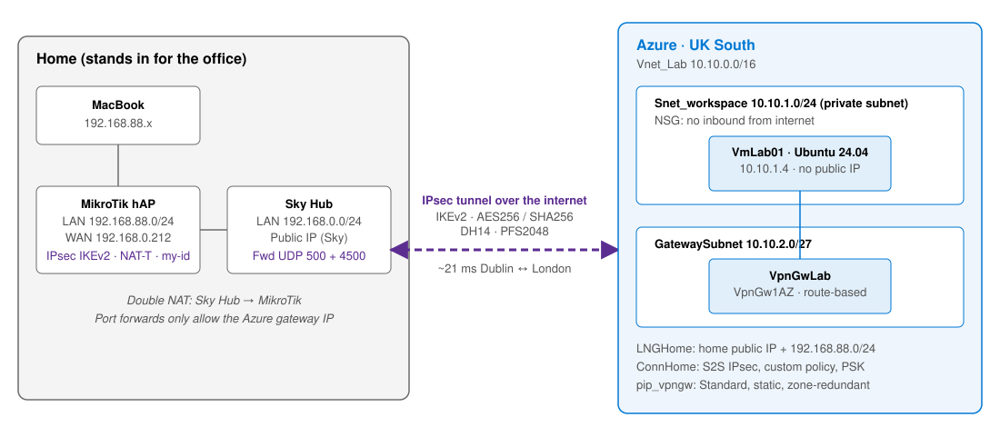

# 01 - Planning and Design

Before building anything I wrote this up the way I'd pitch it to the customer.

## What they need

The firm is moving its business app server into Azure. Staff in the office have to reach it on its private IP as if it was on the office network, the server can't have a public IP, and everything between the office and Azure has to be encrypted. They also want it live within days, using their existing broadband and router, without a big monthly bill.

## Why a site-to-site VPN

A site-to-site VPN puts an Azure VPN Gateway at one end and the office router at the other, with an encrypted IPsec tunnel between them over the normal internet. It can be up in a day and the cost is fixed. In the lab, my home network plays the office and my MikroTik plays the office router.

I did look at the other options. ExpressRoute would work, but it needs a provider, takes weeks and costs far more than a 20-person office needs. A point-to-site VPN is great for remote workers, but every laptop needs a client and it doesn't connect the office as a whole. Bastion is handy for admin access but doesn't give the app network access, and putting a public IP on the server breaks the main requirement. The one downside of a site-to-site VPN is that it's only as good as the office broadband, and there's no SLA on the internet part.

## Design choices

I went with a route-based gateway because it's needed for IKEv2 and leaves room for BGP or point-to-site later. For the size I picked VpnGw1AZ. The old non-AZ SKUs were retired in September 2026, and Gw1AZ is the smallest one that supports a custom IPsec policy, BGP and active-active. Basic doesn't support any of those, so the customer would end up rebuilding later.

Rather than leave Azure on its default list of crypto proposals, I pinned both ends to one strong set: IKEv2 with AES256, SHA256 and DH group 14 for phase 1, then AES256, SHA256 and PFS2048 with a 27000 second lifetime for phase 2. That way nothing can drop down to weaker crypto, and it's written down. Phase 1 is the two routers proving who they are, and phase 2 builds the tunnel the data actually goes through. Every setting has to match on both sides, otherwise you get `NO_PROPOSAL_CHOSEN` and nothing comes up.

I wanted North Europe since it's in Dublin, but that didn't work out (the story is in [troubleshooting](../05-Troubleshooting-and-Cleanup/README.md)), so everything went in UK South. London adds 10 to 20 ms, which doesn't matter for an office app.

I made the GatewaySubnet a /27 because that's Microsoft's recommended minimum, and you can't resize it once a gateway is in it. I left out active-active and BGP. With one router and one internet line they'd just add cost, but I'd turn them on if the customer added a second ISP or office.

## Security

The VM has no public IP and sits in a private subnet, so the tunnel is the only way in. The Sky Hub only forwards the IPsec ports from the Azure gateway's IP, and the MikroTik firewall does the same. The VM uses an SSH key only, with Trusted Launch turned on, and the disk is encrypted at rest by default. The pre-shared key never goes in the repo, and every resource is tagged with `project`, `environment` and `owner`.

For a real customer I'd also keep the pre-shared key in Key Vault, add Bastion, lock the subnet NSG down to the office range, send the gateway logs to Log Analytics with an alert if the tunnel drops, and use Azure Policy to block public IPs on the workload subnet.

## Cost

The gateway is the expensive part, at around €130 to €140 a month. With the public IP and a small VM, the whole thing comes to roughly €150 to €200 a month if it's left running 24/7. Inbound data is free and the first 100 GB out is free too. It's worth checking the [Azure Pricing Calculator](https://azure.microsoft.com/pricing/calculator/) for current prices. For the lab I only ran it for an afternoon.
