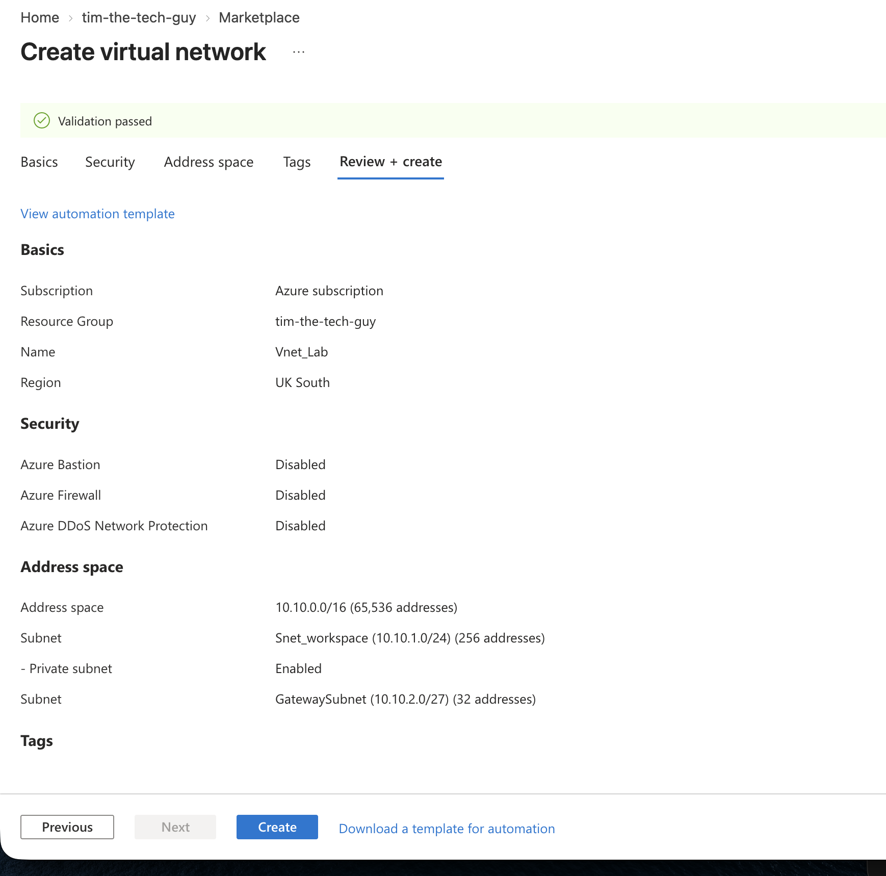
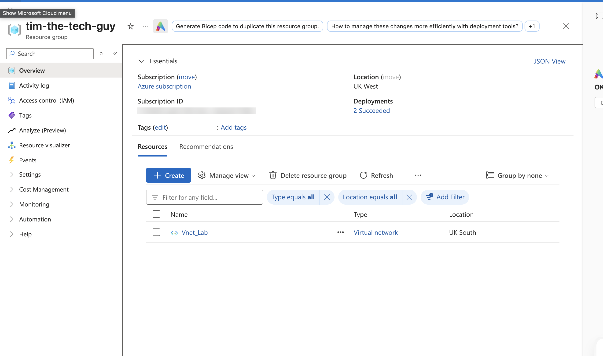

# 02 — Azure Virtual Network

In this section I built the virtual network that everything on the Azure side sits in. It took me three goes to get it into a region that actually worked, and the full story is in [troubleshooting](../08-Troubleshooting/README.md).

---

## Resource group

I kept everything for the lab in one resource group, `tim-the-tech-guy`. That way I can see the whole lab in one place, track the cost, and delete it all in one go at the end.

---

## VNet and subnets

**Settings**
- Name: `Vnet_Lab`
- Region: **UK South**
- Address space: `10.10.0.0/16`
- Security tab: Bastion, Firewall and DDoS Protection all off (they all cost money and the lab doesn't need them)

| Subnet | Range | Private subnet | Why |
| --- | --- | --- | --- |
| `Snet_workspace` | `10.10.1.0/24` | ✅ On | Where the test VM goes. Private subnet means no default outbound internet, which fits the "not on the internet" idea |
| `GatewaySubnet` | `10.10.2.0/27` | ⬜ Off | Where the VPN gateway lives. The name has to be **exactly** `GatewaySubnet` |

A couple of things I learned here:
- I first tried calling it "Gateway SNET". Don't do that! If you pick **Virtual Network Gateway** as the subnet purpose, Azure names it `GatewaySubnet` for you, and the gateway won't deploy into anything else
- I also nearly resized the default subnet to the whole `/22` I'd set at first, which would have left no room for the GatewaySubnet. So I went with a /16 for the VNet and carved two small subnets out of it
- I unticked "private subnet" on the GatewaySubnet. The gateway handles its own public IP, so it shouldn't have that restriction on it

---

## Deployment checkpoint

The VNet deployed in UK South, and both subnets show up. Azure keeps 5 addresses in every subnet for itself, which is why a /24 shows 251 available instead of 256.

Side note: a `NetworkWatcher_<region>` resource also appeared on its own. Azure creates one per region the first time you make a VNet there. It's free to have, and it has a VPN troubleshoot tool that's handy if a tunnel won't come up.
