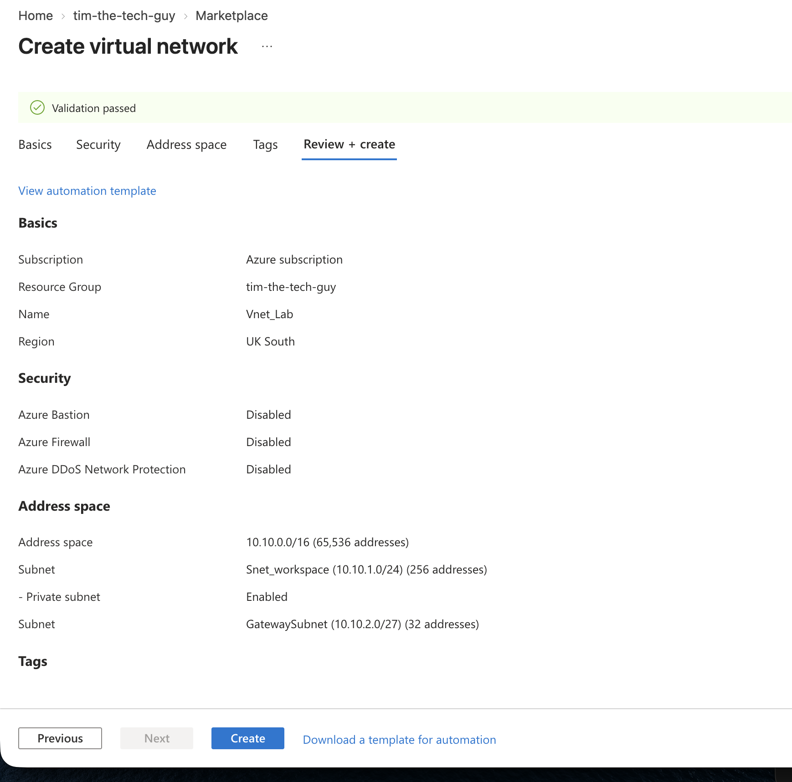
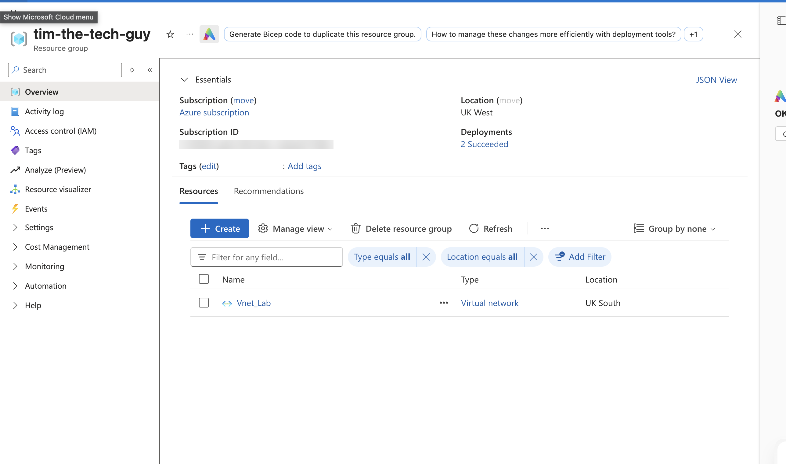
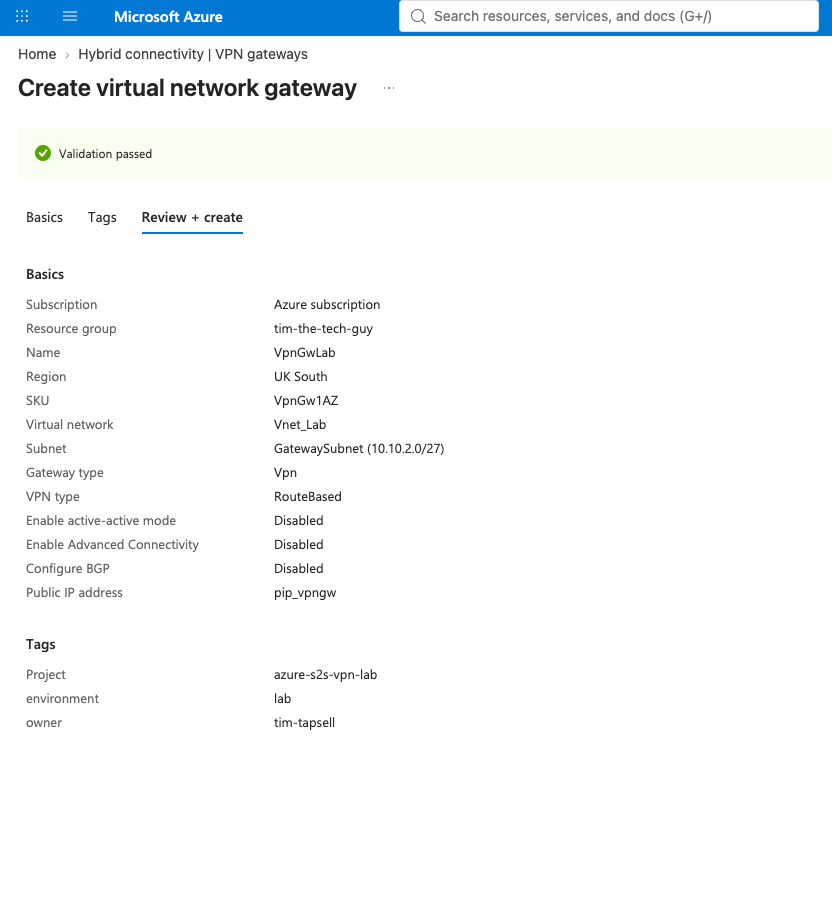
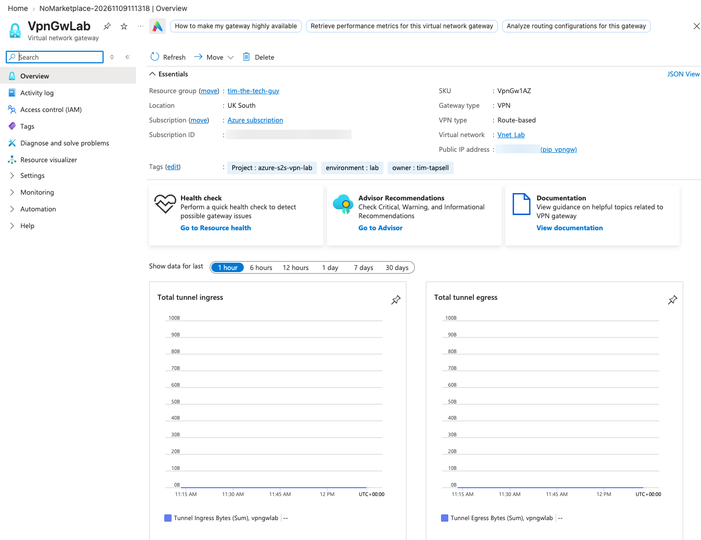
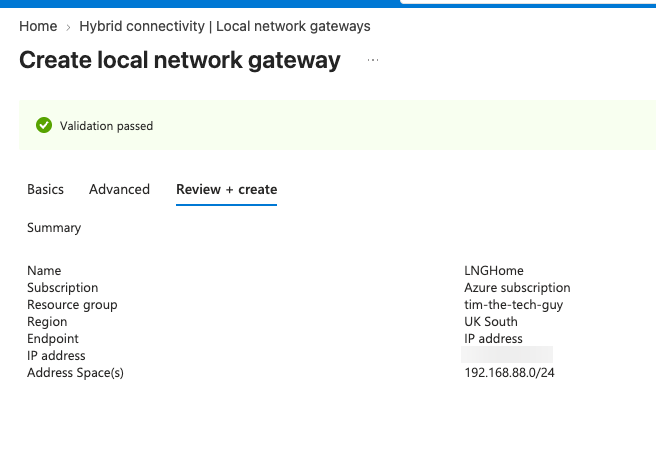
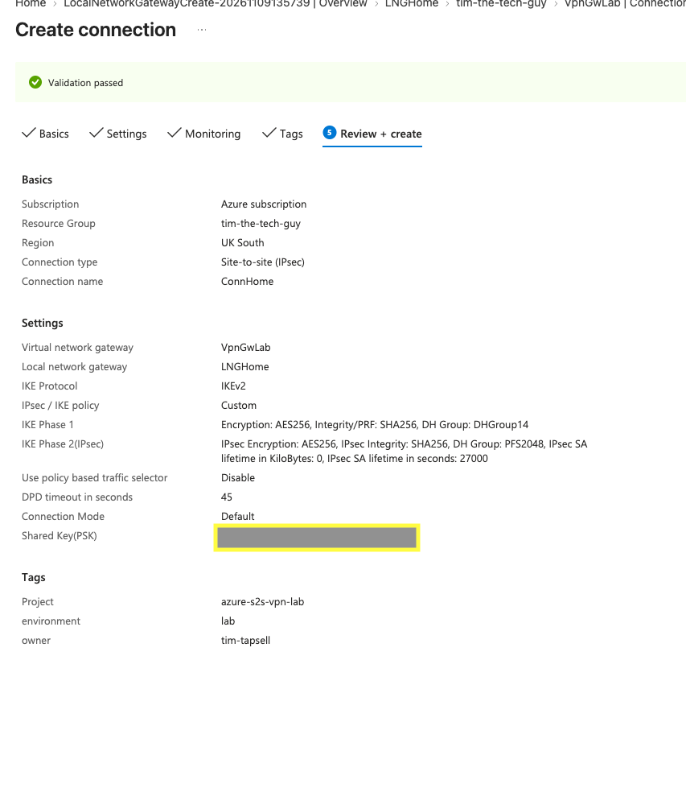
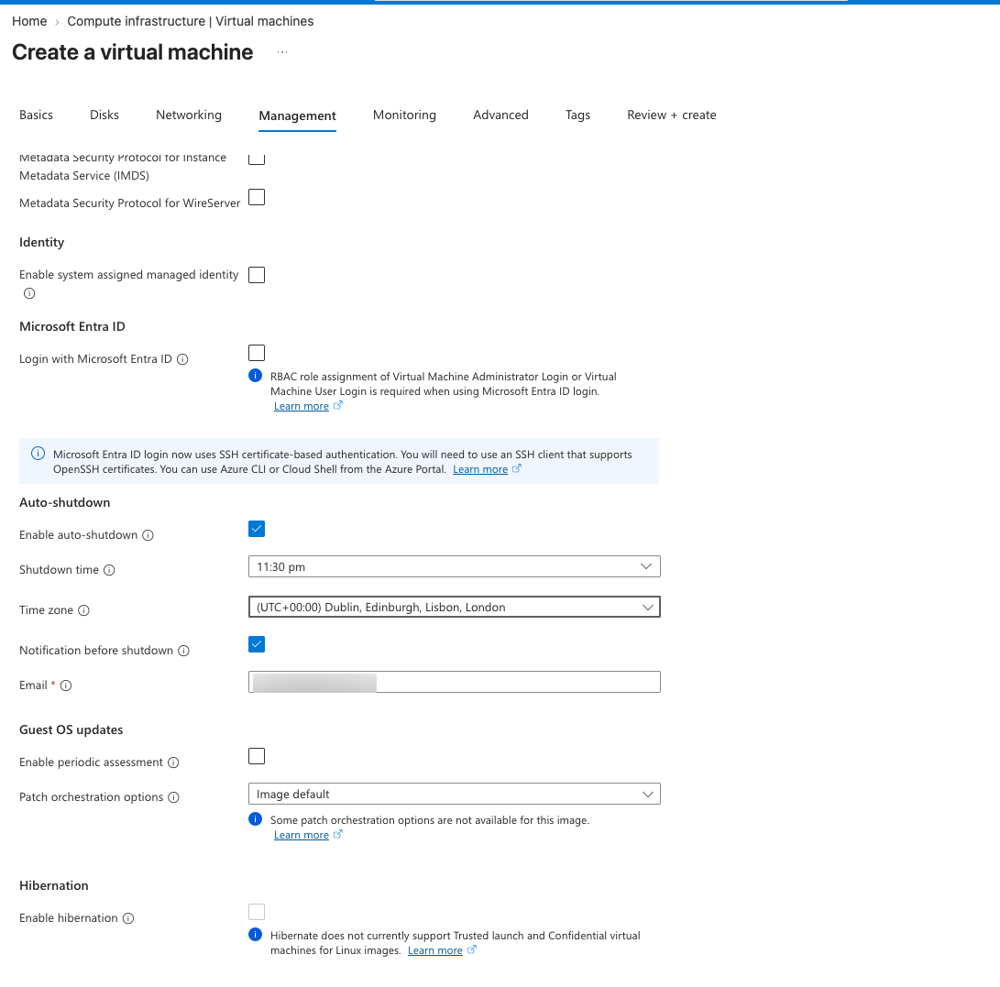
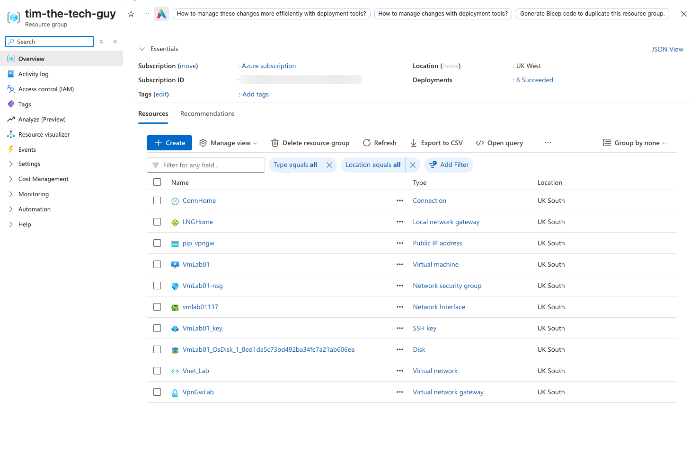

# 02 - Building the Azure Side

Everything in Azure went into one resource group, `tim-the-tech-guy`. That way I could see the whole lab in one place, track what it cost, and delete it all in one go at the end. I also put the same three tags on everything: `project`, `environment` and `owner`.

## Virtual network

I created `Vnet_Lab` in UK South with an address space of `10.10.0.0/16`, and left Bastion, Firewall and DDoS Protection off because the lab doesn't need them. Inside it I made two subnets. `Snet_workspace` (`10.10.1.0/24`) is for the test VM, and I set it as a private subnet so it has no default outbound internet. The second is for the VPN gateway, and it has to be called exactly `GatewaySubnet`. My first try was "Gateway SNET", which doesn't work. If you pick Virtual Network Gateway as the subnet purpose, Azure names it for you. I made it a /27 and left private subnet off, since the gateway manages its own public IP.



Once it deployed, both subnets showed up. A /24 shows 251 free addresses instead of 256 because Azure keeps five in every subnet for itself.



## VPN gateway

The gateway is Azure's end of the tunnel. It's also the slowest thing to deploy and the most expensive part of the lab. I called it `VpnGwLab` and picked UK South, the VpnGw1AZ SKU and `Vnet_Lab`, which picked up the GatewaySubnet on its own. I also gave it a new Standard static public IP, `pip_vpngw`, and left active-active and BGP off. The wizard defaulted to VpnGw2AZ, which costs about twice as much, so I changed it. One thing that caught me out is that the virtual network dropdown only shows VNets in the selected region, so it stays empty until the region is right.



I clicked Create at 11:27 and it finished at about 12:10. While it was building I got on with the local network gateway in another tab. Once it was up, I noted down its public IP, because the Sky Hub and MikroTik both need it later. The tunnel graphs are flat here because nothing was connected yet.



## Local network gateway and connection

The local network gateway is Azure's record of my end. I called it `LNGHome` and gave it my home public IP, plus `192.168.88.0/24` as the address space behind it. To get the IP I used `curl -4 ifconfig.me` in Terminal rather than a "what's my IP" website, for reasons covered in [troubleshooting](../05-Troubleshooting-and-Cleanup/README.md).



Both ends prove who they are with a pre-shared key, so I generated a random one in Terminal and saved it in my password manager:

```bash
openssl rand -base64 32 | tr -d '/+=' | cut -c1-32
```

Then I went to VpnGwLab, opened Connections and clicked Add. I made a site-to-site IPsec connection called `ConnHome` between `VpnGwLab` and `LNGHome`, using the shared key and IKEv2. I set the IPsec policy to Custom with the settings from the design: AES256, SHA256 and DHGroup14 for phase 1, then AES256, SHA256 and PFS2048 for phase 2. The SA lifetime is 27000 seconds with a data limit of 0, which means it only rekeys on time, the same as the MikroTik. I left policy-based traffic selectors off and the DPD timeout at 45 seconds.



At this point the connection showed "Not connected", which is what you'd expect because the MikroTik didn't know about it yet.

## Test VM

I needed something on the Azure side to talk to, so I built `VmLab01`, an Ubuntu 24.04 VM with Trusted Launch. It's set to log in with a new Ed25519 SSH key as `azureuser`. The important part is on the networking tab: the portal creates a public IP by default, so I changed it to None and put the VM in `Snet_workspace` with no public inbound ports.

You might wonder how SSH gets in with no ports open. The NSG's built-in AllowVnetInBound rule uses the `VirtualNetwork` tag, and that tag includes on-prem ranges connected through the VPN gateway. So SSH from `192.168.88.0/24` through the tunnel is allowed, but anything from the internet isn't.

I wanted a cheap B-series size, but my new subscription had no quota for it, so I ended up on Standard_D2als_v6 at about $0.09 an hour (more on that in [troubleshooting](../05-Troubleshooting-and-Cleanup/README.md)). I used a 30 GB Standard SSD and didn't use Spot. A Spot VM can be shut down with 30 seconds' notice, and that would have looked exactly like the VPN failing. I also set auto-shutdown for 23:30 in case I forgot about it. That only stops the VM though, not the gateway, which keeps billing until you delete it.



Azure offered the private key as a download when I clicked Create, so I moved it into `~/.ssh` and locked it down:

```bash
mkdir -p ~/.ssh && mv ~/Downloads/VmLab01_key.pem ~/.ssh/ && chmod 600 ~/.ssh/VmLab01_key.pem
```

With that, everything for the lab was in one resource group in UK South. The VM got `10.10.1.4`, which is the first address Azure hands out in a subnet.


