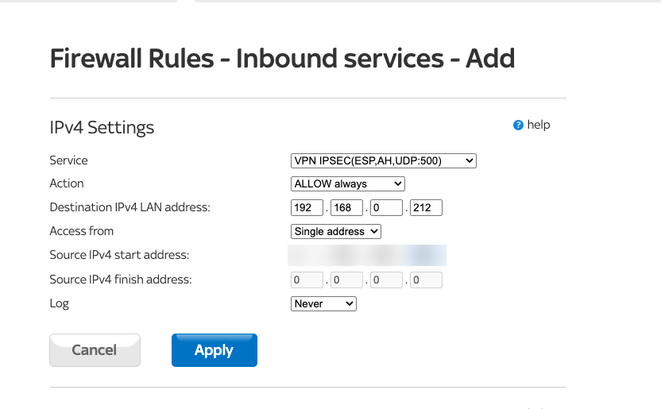
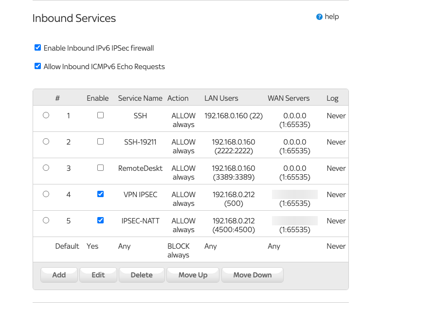

# 03 - Home Network: Sky Hub and MikroTik

This was the most interesting part, because my MikroTik isn't directly on the internet. It's plugged in behind the Sky Hub:

```
Internet ── Sky Hub (public IP) ── 192.168.0.0/24 ── MikroTik (WAN 192.168.0.212) ── 192.168.88.0/24 ── my Mac
```

That's double NAT. IPsec can get through it using NAT-Traversal, but it needs a bit of extra setup on both boxes. Before doing anything, I checked that the IP from `curl -4 ifconfig.me` really was a Sky address and not CGNAT. Behind CGNAT you don't get a public IP of your own, and a site-to-site VPN won't work.

## Port forwarding on the Sky Hub

IPsec needs two UDP ports to reach the MikroTik. UDP 500 is IKE, where the two ends negotiate. UDP 4500 is NAT-Traversal, which wraps the encrypted traffic in UDP so it gets through the NAT.

On the Sky Hub, port forwarding lives under Security, then Firewall Rules, then Inbound Services. I spent a while looking under the WAN settings first. For UDP 500 I used the built-in "VPN IPSEC" service, pointed it at the MikroTik on `192.168.0.212`, and set it to only allow the Azure gateway's IP. Anything else trying that port just hits the Sky Hub's default block rule.



UDP 4500 isn't in the Sky Hub's list, so I made a custom service for it under Security, then Services, and added a second rule with the same settings. The three older rules in the screenshot are disabled ones from a previous project.



## MikroTik config

I wrote the tunnel config as a RouterOS script so I could run it again if I needed to: [`mikrotik/ipsec-azure.rsc`](../mikrotik/ipsec-azure.rsc). It sets up the phase 1 profile and phase 2 proposal to match the Azure connection exactly, adds the Azure gateway as an IKEv2 peer, and creates a policy that encrypts traffic between `192.168.88.0/24` and `10.10.0.0/16`. It also opens the firewall for IPsec from the Azure gateway only, and clamps the TCP MSS to 1350 so SSH and HTTPS don't hang on oversized packets.

Two parts of it are worth explaining.

The first is the double NAT. By default the MikroTik identifies itself with its WAN IP, which is the private `192.168.0.212`. Azure is expecting the public IP I gave the local network gateway. Setting `my-id=address:<my public IP>` on the identity fixes that. Without it, authentication fails.

The second is the classic MikroTik gotcha. The script adds a `srcnat accept` rule for the tunnel traffic, and it has to sit above the masquerade rule. Otherwise the router rewrites the source address before IPsec sees the packet, and the traffic goes out unencrypted and never reaches Azure.

## Applying it

I didn't have Winbox on this Mac, so I used the web interface on `192.168.88.1`. First I took a backup with `/system backup save name=pre-azure`. Then I opened the script in TextEdit, with smart quotes turned off because curly quotes break RouterOS, and filled in the two IPs and the pre-shared key. I uploaded it under Files, turned on Safe Mode so the router would roll back if I locked myself out, and ran it:

```
/import file-name=ipsec-azure-live.rsc verbose=yes
```

`verbose=yes` prints each line as it runs, so you can see exactly where it breaks if something's wrong. Mine went through cleanly, so I turned Safe Mode off to keep the changes.
