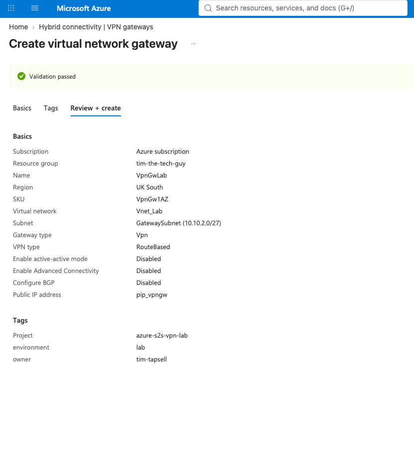
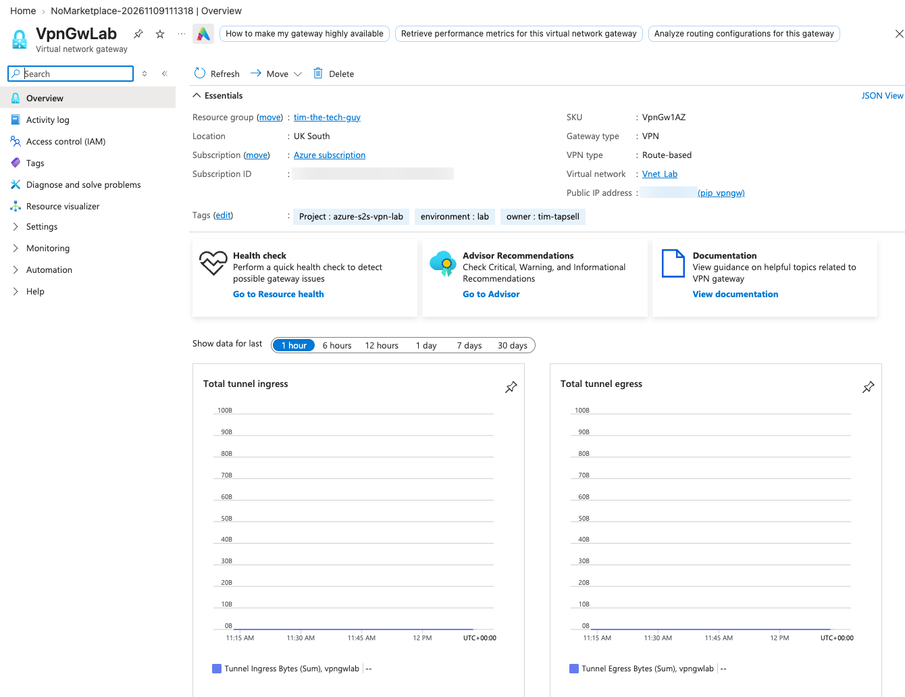

# 03 — VPN Gateway

This is Azure's end of the tunnel. It's also the slowest part to deploy and the most expensive part of the lab, so I made sure everything else was ready before I clicked Create.

---

## Settings

| Setting | Value |
| --- | --- |
| Name | `VpnGwLab` |
| Region | UK South |
| Gateway type | VPN |
| SKU | **VpnGw1AZ** |
| Virtual network | `Vnet_Lab` (it picked up `GatewaySubnet` automatically) |
| Public IP | New Standard static IP, `pip_vpngw` |
| Active-active | Disabled |
| BGP | Disabled |
| Key Vault access | Disabled |

A few things worth knowing:
- The wizard defaulted the region to UK West and the SKU to **VpnGw2AZ**. Gw2 is about twice the price and I didn't need the speed, so I changed it to Gw1
- The Virtual network dropdown only shows VNets in the selected region. That's why mine was empty until I fixed the region
- **The SKU name explained:** `VpnGw` = VPN gateway, `1` = the size (about 650 Mbps, up to 30 tunnels), `AZ` = spread across availability zones, so it survives a datacentre failure in the region

I also added the same three tags I used on everything (`project`, `environment`, `owner`).

---

## The wait

I clicked Create at 11:27 and it finished at about 12:10, so around 40 minutes. The public IP was ready in seconds, and all the time was the gateway itself. While it was building I moved on to the local network gateway in another tab.

---

## Deployment checkpoint

The gateway is up in UK South: VpnGw1AZ, route-based, with its public IP (blurred). The tunnel graphs at the bottom are flat because nothing was connected yet. Compare them with the ones in [section 7](../07-Testing-the-Tunnel/README.md).

I wrote down the gateway's public IP here, because the MikroTik needs it later.
