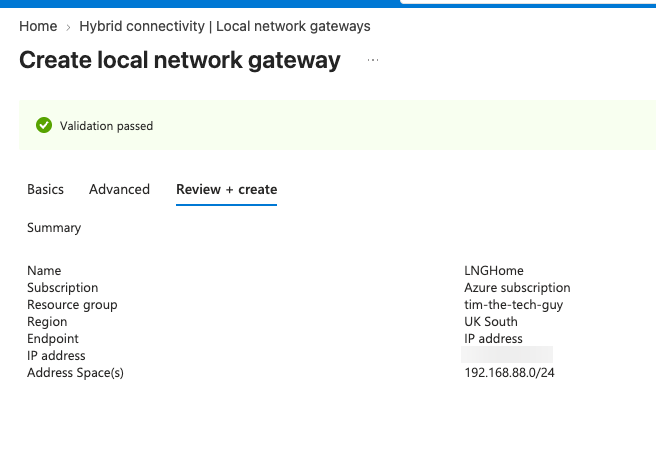
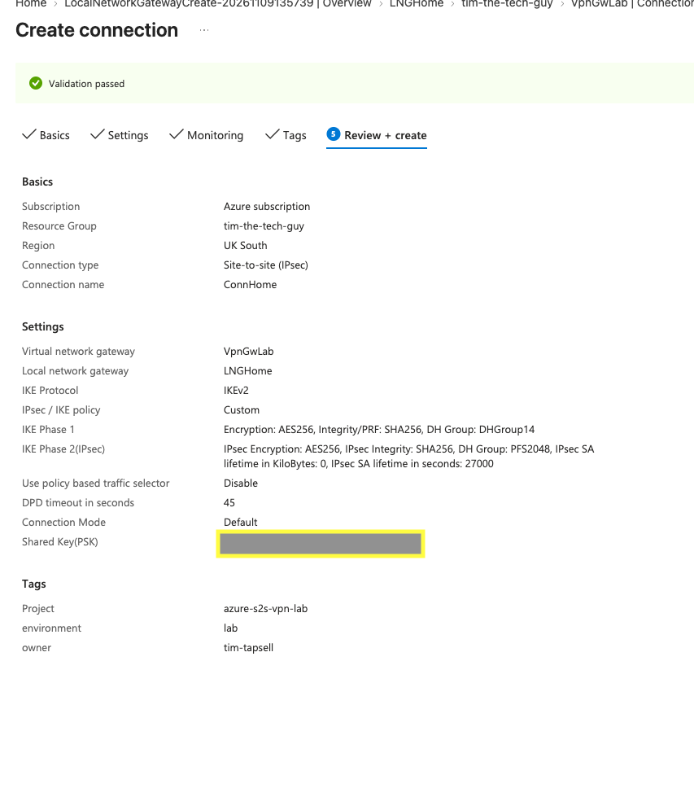

# 04 — Local Network Gateway and Connection

The VPN gateway is Azure's end. Now Azure needs to know about **my** end: where my router is on the internet, and what network sits behind it. Then the connection joins the two together.

---

## Step 1 — Local network gateway

The local network gateway is just Azure's record of the on-prem site.

| Setting | Value |
| --- | --- |
| Name | `LNGHome` |
| Region | UK South |
| Endpoint | IP address |
| IP address | My home public IP (blurred) |
| Address space | `192.168.88.0/24`, my MikroTik LAN |

Getting the public IP right turned into its own little adventure. My browser told me my IP belonged to "Google LLC, Data Center, London", which made me think something was routing my traffic somewhere odd. It turned out the browser was using a privacy relay over IPv6. `curl -4 ifconfig.me` in Terminal gives the real IPv4 address, and that range is registered to Sky. Full story in [troubleshooting](../08-Troubleshooting/README.md).



---

## Step 2 — Pre-shared key

Both ends prove who they are with a shared secret, so I generated a long random one in Terminal:

```bash
openssl rand -base64 32 | tr -d '/+=' | cut -c1-32
```

I saved it in my password manager. Chrome popped up offering to save it as a website password because it thought the Shared Key box was a login field, so I said no to that. The key never goes in the repo.

---

## Step 3 — The connection

I opened **VpnGwLab → Connections → Add**:

| Setting | Value |
| --- | --- |
| Connection type | Site-to-site (IPsec) |
| Name | `ConnHome` |
| Virtual network gateway | `VpnGwLab` |
| Local network gateway | `LNGHome` |
| Authentication | Shared key (PSK) |
| IKE protocol | IKEv2 |
| IPsec / IKE policy | **Custom** |
| Phase 1 | AES256 · SHA256 · DHGroup14 |
| Phase 2 | AES256 · SHA256 · PFS2048 |
| SA lifetime | 27000 seconds, 0 KB (0 = no data limit, so it only rekeys on time, same as the MikroTik) |
| Policy-based traffic selector | Disable |
| DPD timeout | 45 seconds |

I chose Custom instead of Default so both ends are pinned to the same strong crypto. These exact values go into the MikroTik config later. If one of them doesn't match, the tunnel won't come up.

The Monitoring tab ("Connection Monitor") is greyed out because it's only for ExpressRoute, so I skipped it.



---

## Checkpoint

The connection was created and showed **Not connected**. That's exactly what you'd expect at this point, because the MikroTik doesn't know about it yet.
