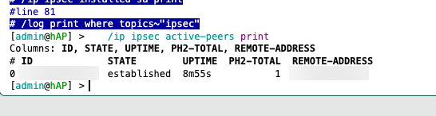
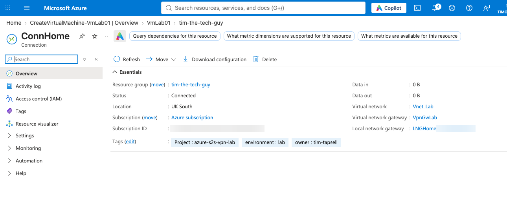
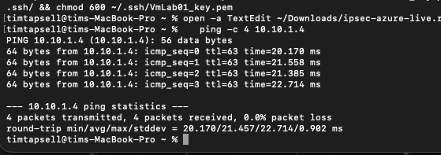
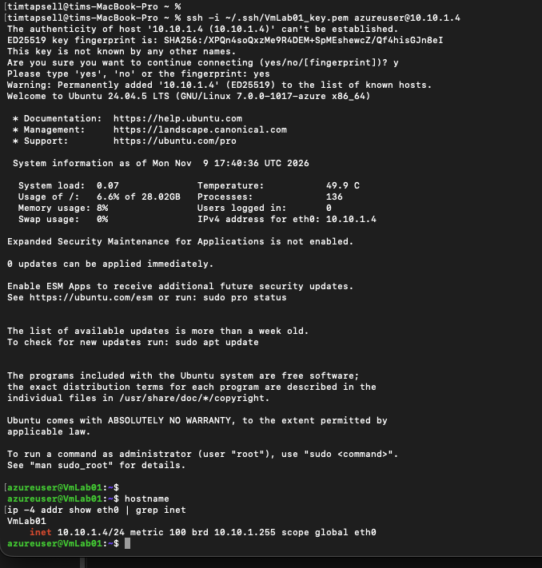
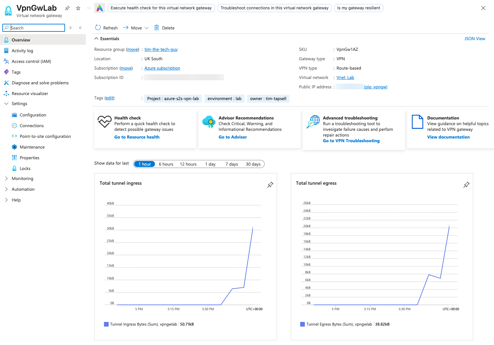
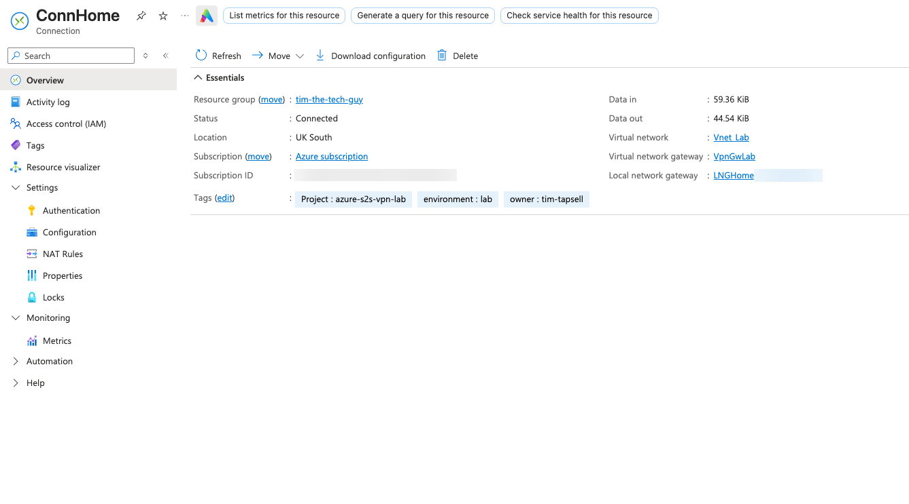

# 04 - Testing the Tunnel

First I checked the tunnel was up on the MikroTik with `/ip ipsec active-peers print`. The Azure gateway showed as established with a phase 2 SA installed, and it had already been up for about nine minutes by the time I looked.



In Azure, ConnHome had changed from Not connected to Connected. Data in and out was still 0 B because nothing had gone through it yet.



Next I pinged the VM's private IP from my Mac:

```bash
ping -c 4 10.10.1.4
```

All four came back with no loss, at about 21 ms. The TTL was 63, and since Linux starts at 64, the packet only crossed one router on the way: my MikroTik. As far as my Mac could tell, the VM was one hop away, with the whole internet hidden inside the tunnel.



Then the real test, SSH:

```bash
ssh -i ~/.ssh/VmLab01_key.pem azureuser@10.10.1.4
```

I accepted the host fingerprint and I was in. Running `hostname` and `ip -4 addr` confirmed I was on VmLab01 at `10.10.1.4`. That VM has no public IP, so the only way I could reach it from my living room was through the tunnel.



Finally I went back to the gateway in Azure. The tunnel graphs that were flat earlier had jumped to about 51 kB in and 39 kB out, right around the time I was testing:



The connection itself showed 59.36 KiB in and 44.54 KiB out, so Azure had seen the traffic too.


