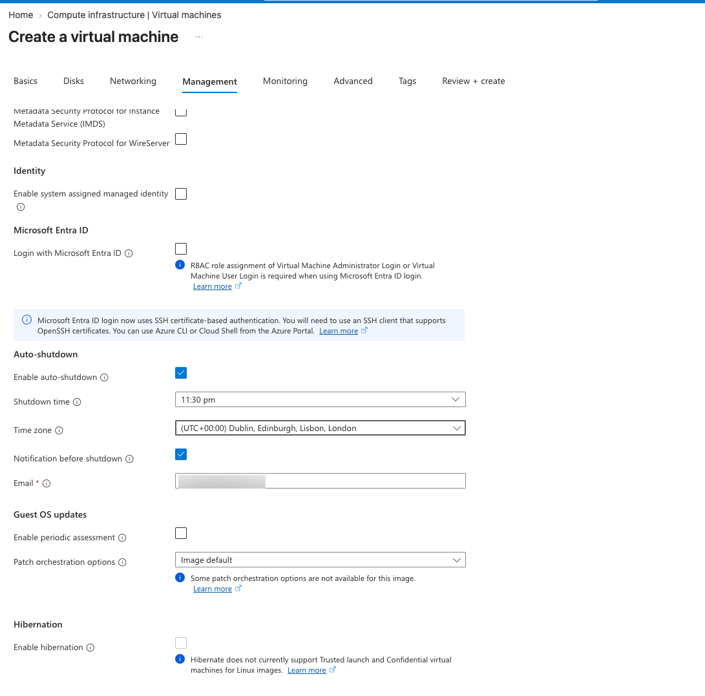
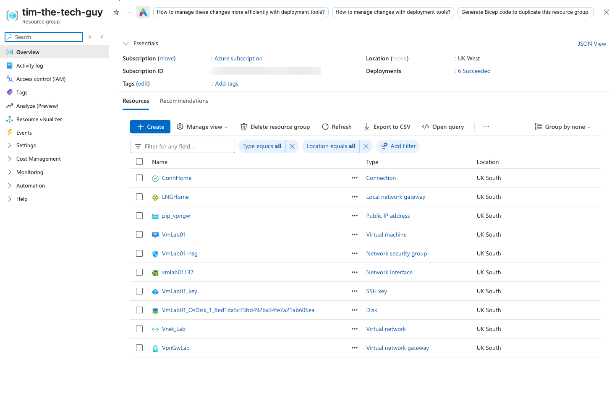

# 05 — Test VM

I needed something on the Azure side to talk to through the tunnel, so I built a small Ubuntu VM with **no public IP**. The only way to reach it is through the VPN, so if I can SSH in from home, the tunnel works.

---

## Basics

| Setting | Value |
| --- | --- |
| Name | `VmLab01` |
| Region | UK South |
| Availability | No infrastructure redundancy required |
| Security type | Trusted launch (Secure Boot + vTPM) |
| Image | Ubuntu Server 24.04 LTS (x64 Gen2) |
| Size | **Standard_D2als_v6** (see below for why not a B-series) |
| Spot discount | Off |
| Authentication | SSH public key, user `azureuser`, new **Ed25519** key pair |
| Public inbound ports | None |

**Why not Spot?** Spot VMs are much cheaper, but Azure can shut them down at any time with 30 seconds' warning. If that happened halfway through testing, it would look like the VPN had failed, and I'd waste time troubleshooting the wrong thing. For a few hours of lab time the saving is tiny.

### The size problem

This took a few attempts:
1. The default, **D2s_v3**, said *"NotAvailableForSubscription"* in UK South
2. I picked **B2ats_v2** (about $8/month, perfect for a lab). It passed the form, but validation failed with **QuotaExceeded**: my new subscription had a vCPU quota of **0** for the Basv2 family
3. In the size picker, all the B-series sizes were sitting under "Insufficient quota – family limit". The families at the top of the list were the ones I actually had quota for, so I took the cheapest 2-vCPU size in D-series v6: **D2als_v6**, at about $0.09 an hour

For a real customer I'd raise a quota request for the B-series and use a burstable size, because a test server like this doesn't need a D-series. Details in [troubleshooting](../08-Troubleshooting/README.md).

---

## Disks

- 30 GB **Standard SSD**, deleted along with the VM
- Encrypted at rest by default with a platform-managed key
- I ignored the Premium SSD suggestion, because there's no heavy disk workload here

---

## Networking

| Setting | Value |
| --- | --- |
| Virtual network / subnet | `Vnet_Lab` / `Snet_workspace` (10.10.1.0/24) |
| **Public IP** | **None** (the portal defaults to creating one, so I changed it) |
| NIC network security group | Basic, with no public inbound ports |
| Delete NIC when VM is deleted | ✅ |

With no inbound ports open, how does SSH get in? The NSG's built-in **AllowVnetInBound** rule uses the `VirtualNetwork` tag, and that tag **includes the on-prem range connected through the VPN gateway**. So traffic from `192.168.88.0/24` through the tunnel is allowed, and traffic from the internet isn't.

(The Review + create page showed the NIC NSG as "None" even though I'd picked Basic. It turned out to be a display glitch in the new VM wizard, because `VmLab01-nsg` got created anyway. You can see it in the resource list below.)

---

## Management

- **Auto-shutdown at 23:30** (Dublin time), with an email warning first. It's a guardrail so the VM can't run all night if I forget it. It only stops the VM though, **not** the VPN gateway, which bills until you delete it
- Managed identity, Entra ID login and backup were all off, and patching was left on the image default



---

## Monitoring and advanced

- Boot diagnostics on, with a managed storage account, so I could see the console if the VM didn't boot
- Recommended alert rules off (they create paid alert rules)
- No extensions, no cloud-init, no capacity reservation

---

## Saving the SSH key

When I clicked Create, Azure offered the private key as a download. I moved it into `~/.ssh` and locked it down so only my user can read it, which SSH insists on:

```bash
mkdir -p ~/.ssh && mv ~/Downloads/VmLab01_key.pem ~/.ssh/ && chmod 600 ~/.ssh/VmLab01_key.pem
```

---

## Deployment checkpoint

Everything for the lab is now in one resource group, all in UK South:



The VM got the private IP **10.10.1.4**. That's the first usable address in the subnet, because Azure reserves .0–.3.
