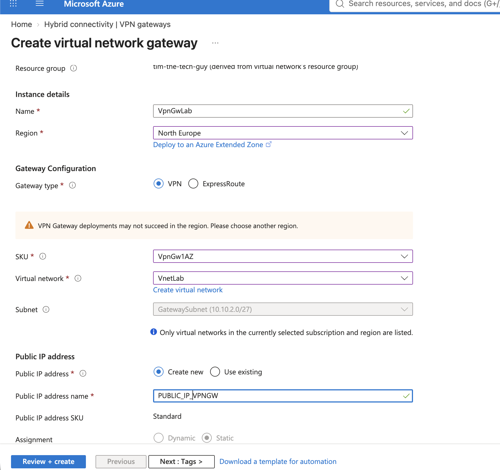
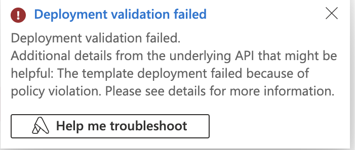
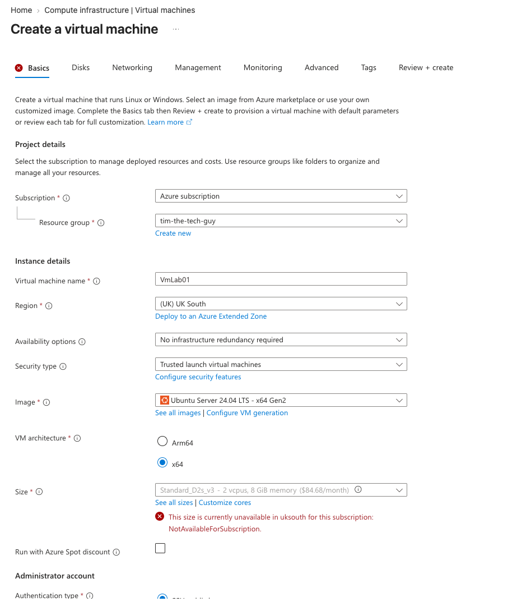
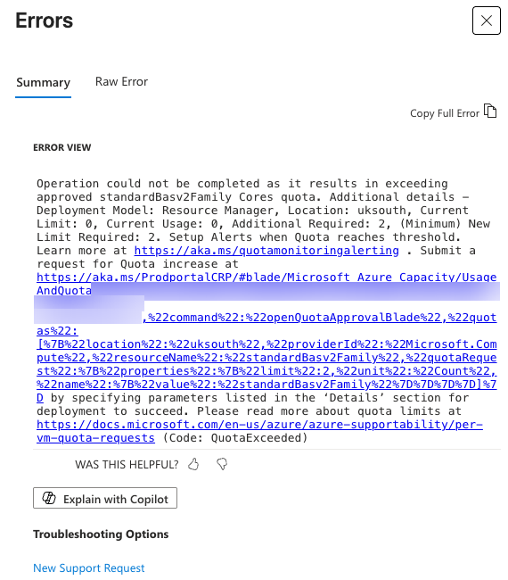

# 05 - Troubleshooting and Cleanup

The tunnel itself came up first time. Getting to that point was where things went wrong.

## Finding a region that worked

My first VNet was in North Europe, since it's in Dublin. When I opened the gateway wizard, the portal warned that VPN gateways might not deploy in that region. It was only a warning, but a failed gateway means waiting 30 to 45 minutes for nothing, so I didn't risk it. A VNet can't be moved between regions, so I deleted it and tried West Europe.

The VNet in West Europe failed to deploy twice. The Errors pane said there were no errors, but the notification bell said it had failed because of a policy violation. When I checked Policy, then Assignments, there was nothing there at all.

It turns out new subscriptions come with a hidden region restriction managed by Azure (`RequestDisallowedByAzure`). It doesn't show up under Policy, and only a support request can lift it. UK South worked straight away with no capacity warning, so everything went there. If the Errors pane is ever empty, check the notification bell and the Activity log JSON, because that's where the real reason is.

## The "Google LLC" home IP

When I checked my public IP on a website, it said Google LLC, Data Center, London, which isn't what you'd expect on Sky broadband. I spent a while checking for a VPN or proxy before realising nothing was wrong. My browser's IPv6 traffic was going through a privacy relay, and the website was showing that address. `curl -4 ifconfig.me` forces IPv4, which goes straight out through the Sky Hub, and that address is registered to Sky. That's the one the local network gateway needs.

## VM size and quota

The default VM size, D2s_v3, wasn't available in UK South on my subscription.

I tried B2ats_v2 instead, at about $8 a month, but validation failed with QuotaExceeded. My subscription had a quota of 0 vCPUs for that family.

In the size picker, the families at the top of the list are the ones you have quota for, so I took the cheapest 2 vCPU size there, D2als_v6. For a real customer I'd raise a quota request for the B-series instead, which is often approved within minutes.

## Smaller things

The VM review page showed the NIC NSG as None even though I'd picked Basic, but the NSG was created anyway. Tags I'd added to the VNet didn't stick, so I added them afterwards on the resource. Chrome also tried to save the pre-shared key as a website password, which I said no to.

If the tunnel hadn't come up, these are the things I'd have checked first. `NO_PROPOSAL_CHOSEN` means the crypto settings don't match. `AUTHENTICATION_FAILED` usually means the key or the `my-id` is wrong. If both phases are up but ping fails, the NAT bypass rule is probably in the wrong place. If ping works but SSH hangs, it's MTU, so clamp the MSS. Network Watcher's VPN troubleshoot tool is also worth knowing about.

## Cost

The gateway ran for about seven hours and the VM for about two, so the whole lab came to roughly €1.50. Left running 24/7 the same setup would be about €200 a month, nearly all of it the gateway, so deleting it straight away really matters. Because everything was tagged, Cost Management could show me the cost of just this lab. I also had a budget alert on the subscription.

## Cleanup

In Azure I deleted the `tim-the-tech-guy` resource group, which removed everything in one go. On the MikroTik I removed the tunnel config (the commands are in [`mikrotik/teardown.rsc`](../mikrotik/teardown.rsc)) and deleted the uploaded script, because it had the pre-shared key in it. On the Sky Hub I deleted both port forwarding rules, and on my Mac I deleted the filled-in script and the VM's SSH key.

## What I'd do next

Next I'd like to deploy the same thing from the Bicep in [`infra/`](../infra/) and compare it with the portal build. I'd also put the pre-shared key in Key Vault and tighten the NSG to only allow the home range. After that, I'd try point-to-site with Entra ID sign-in for remote users, and an active-active gateway with BGP.
