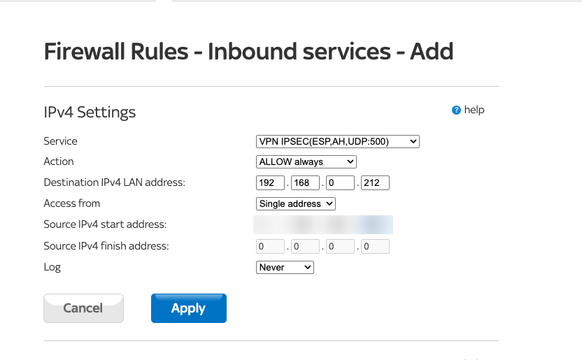
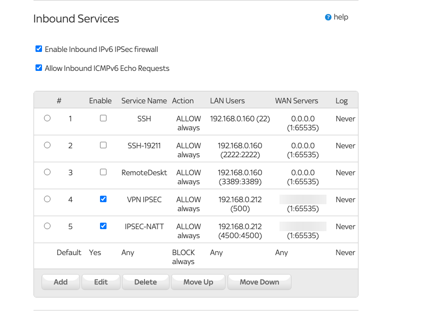

# 06 — Home Network: Sky Hub and MikroTik

This is the on-prem side. It was the most interesting part, because my MikroTik isn't directly on the internet: it's plugged in behind the Sky Hub.

```
Internet ── Sky Hub (public IP) ── 192.168.0.0/24 ── MikroTik (WAN 192.168.0.212) ── 192.168.88.0/24 ── my Mac
```

That's **double NAT**. It's not the same as CGNAT, and IPsec can work through it using NAT-Traversal, but it needs a bit of extra setup on both boxes.

---

## Step 1 — Check it isn't CGNAT

If your ISP puts you behind CGNAT, you don't have your own public IP and a site-to-site VPN won't work. So first I checked that the IP from `curl -4 ifconfig.me` was a real Sky address, and that it matched what I'd put in the Azure local network gateway.

---

## Step 2 — Port forwarding on the Sky Hub

IPsec needs two UDP ports to reach the MikroTik:
- **UDP 500**: IKE, where the two ends negotiate
- **UDP 4500**: NAT-Traversal. Because there's NAT in the path, the encrypted ESP traffic gets wrapped inside UDP 4500

On the Sky Hub, port forwarding lives under **Security → Firewall Rules → Inbound Services** (not under WAN setup, which is where I looked first).

**Rule 1: UDP 500**
- Service: the built-in **VPN IPSEC (ESP, AH, UDP:500)**
- Action: ALLOW always
- Destination: the MikroTik, `192.168.0.212`
- Access from: **single address**, the Azure gateway's public IP

I locked it down to the Azure gateway's IP on purpose. Anything else on the internet trying those ports just hits the Sky Hub's default BLOCK rule.



**Rule 2: UDP 4500**

UDP 4500 isn't in the Sky Hub's list, so I went to **Security → Services** and created a custom service called `IPSEC-NATT` (UDP 4500–4500). Then I added a second inbound rule with exactly the same settings as rule 1.



Both rules are enabled, both point to the MikroTik, and both only allow the Azure gateway in. (The three older rules in that list are disabled ones from a previous project.)

---

## Step 3 — MikroTik config

I wrote the whole tunnel config as a RouterOS script so it's repeatable: [`mikrotik/ipsec-azure.rsc`](../mikrotik/ipsec-azure.rsc). The repo version has placeholders. On my machine I filled in the two IPs and the pre-shared key.

**What's in it:**

| Section | What it does |
| --- | --- |
| IPsec profile (phase 1) | SHA256, AES-256, modp2048 (DH14), NAT-T on, dead peer detection |
| Peer | The Azure gateway's IP, IKEv2 |
| Identity | Pre-shared key, plus `my-id=address:<my public IP>` |
| Proposal (phase 2) | SHA256, AES-256-CBC, PFS modp2048, 7h30m lifetime (matches Azure's 27000 s) |
| Policy | Encrypt `192.168.88.0/24 ↔ 10.10.0.0/16` |
| NAT bypass | Stops masquerade from rewriting tunnel traffic |
| Firewall | Accept IKE/NAT-T/ESP **from the Azure gateway only**, and accept tunnel traffic through the forward chain |
| MSS clamp | TCP MSS 1350 both ways (Microsoft's recommendation), so SSH/HTTPS doesn't hang on oversized packets |

**The double-NAT bit:** by default the MikroTik identifies itself with the IP on its WAN port, which is the private `192.168.0.212`. Azure is expecting the public IP I gave the local network gateway. Setting `my-id` to my public IP fixes that. Without it, you get authentication failures.

**The NAT bypass is the classic MikroTik gotcha:** if the `srcnat accept` rule isn't above the masquerade rule, the router rewrites the source address before IPsec gets a look at the packet, so the traffic goes out unencrypted and never reaches Azure.

---

## Step 4 — Applying it

I didn't have Winbox on this Mac, so I used WebFig, the MikroTik's web UI, by browsing to `192.168.88.1`. On newer RouterOS 7 the full menu is under **Advanced** (that's what used to be called WebFig).

1. **Backed up first:** `/system backup save name=pre-azure`
2. Opened the `.rsc` in TextEdit (plain text, smart quotes off, because curly quotes break RouterOS) and pasted the pre-shared key in place of `PSK_HERE`
3. Uploaded it under **Files → Upload**
4. Turned on **Safe Mode**, so if anything cut me off, the router would roll the changes back
5. Ran it in the terminal:
   ```
   /import file-name=ipsec-azure-live.rsc verbose=yes
   ```
   `verbose=yes` prints every line as it runs, so you can see exactly where it fails if something's wrong. Mine went through cleanly
6. Turned Safe Mode off to keep the changes

**A `.rsc` file is a RouterOS script.** It's the same commands you'd type into the terminal, saved in a file. Lines starting with `/` go into a menu, `add` creates an entry, `\` continues onto the next line, and `#` is a comment. It's the on-prem version of what the Bicep does for Azure.
