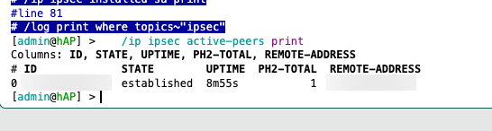
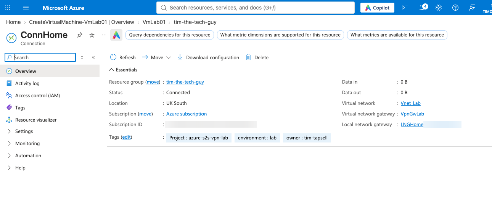
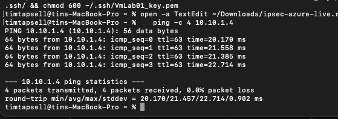
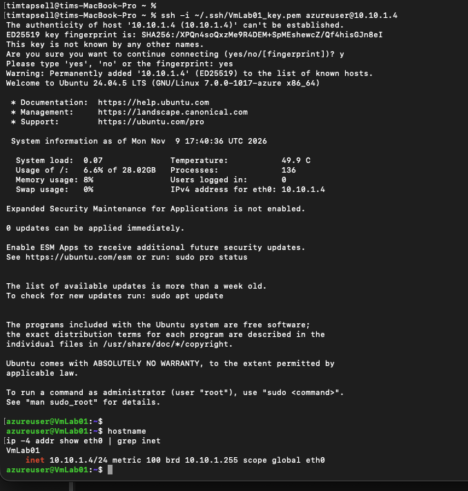
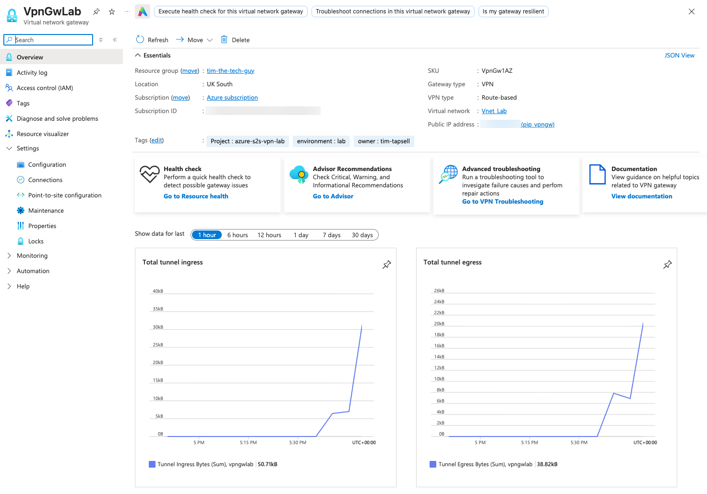
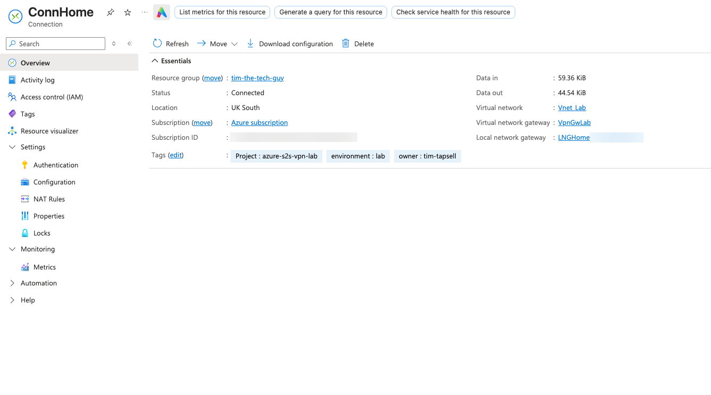

# 07 — Testing the Tunnel

This is where everything finally connects.

---

## 1. Is the tunnel up?

**On the MikroTik:**
```
/ip ipsec active-peers print
```
The Azure gateway showed as **established**, with one phase 2 SA installed, and it had already been up for about 9 minutes by the time I checked.



**In Azure:** ConnHome had gone from *Not connected* to **Connected**.



Data in/out was still 0 B, because nothing had actually gone through the tunnel yet.

---

## 2. Ping

From my Mac, which is on the MikroTik's LAN (`192.168.88.x`), to the VM's private IP:

```bash
ping -c 4 10.10.1.4
```

4 out of 4 replies, **0% packet loss, about 21 ms average**.



Two things I noticed:
- **ttl=63.** Linux starts at 64, so the packet only crossed **one** router on the way, my MikroTik. From my Mac's point of view the Azure VM is one hop away, and the tunnel hides the whole internet in between
- **About 21 ms** is normal for Dublin to London, which backs up the decision to use UK South

---

## 3. SSH

```bash
ssh -i ~/.ssh/VmLab01_key.pem azureuser@10.10.1.4
```

I said yes to the host fingerprint the first time, and I was in. Then, to prove which machine I was on:

```
azureuser@VmLab01:~$ hostname
VmLab01
azureuser@VmLab01:~$ ip -4 addr show eth0 | grep inet
    inet 10.10.1.4/24 metric 100 brd 10.10.1.255 scope global eth0
```



That VM has **no public IP**. The only way I could SSH into it from my living room is through the tunnel, so this is the proof that the whole thing works end to end.

---

## 4. Traffic through the tunnel

After the ping and SSH, the gateway's tunnel graphs jumped from flat to about **51 kB in / 39 kB out**, right at the time I was testing (about 5:35 PM):



And the connection itself showed **59.36 KiB in / 44.54 KiB out**:



---

## Checkpoint

- Tunnel established on both ends ✅
- Ping across the tunnel ✅
- SSH into a private-only VM ✅
- Azure measuring real traffic through the tunnel ✅
