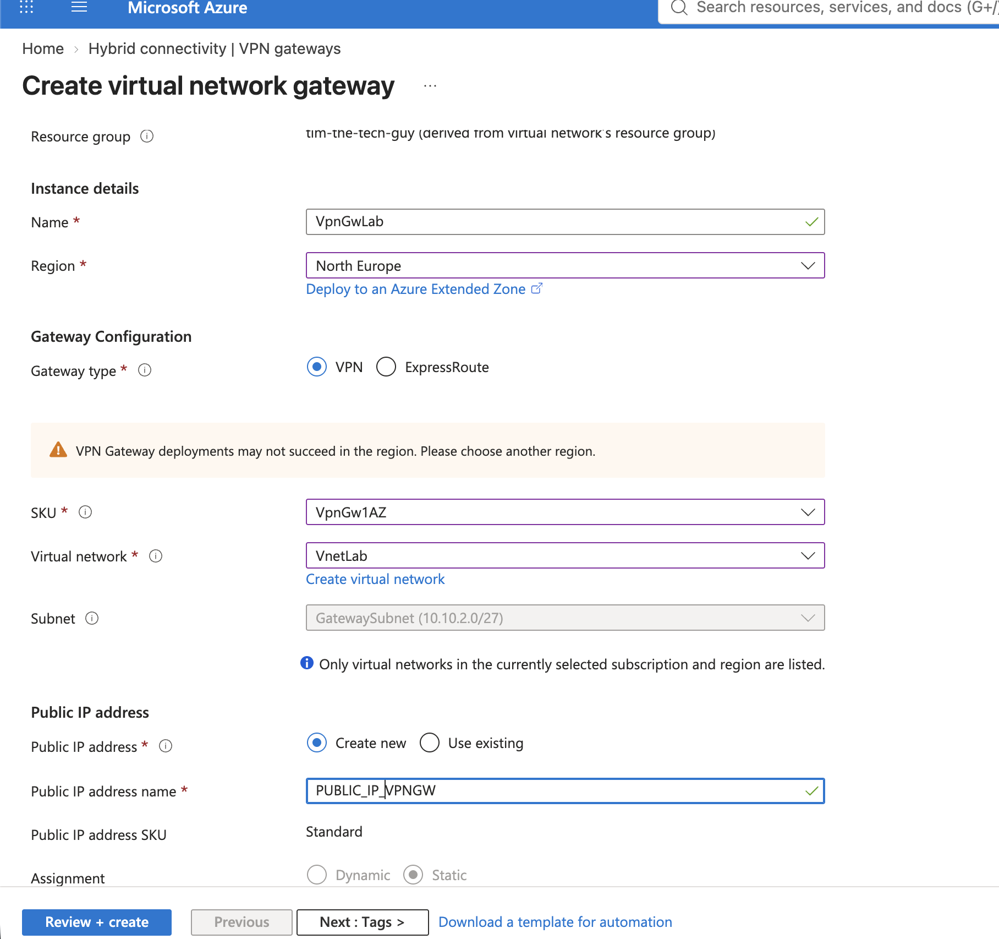
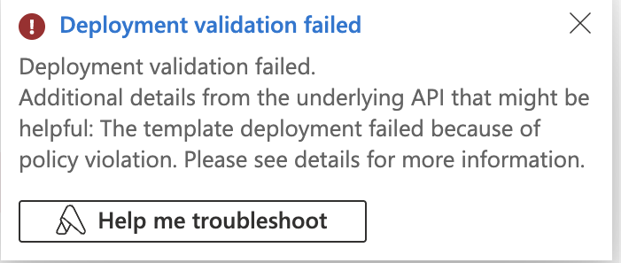
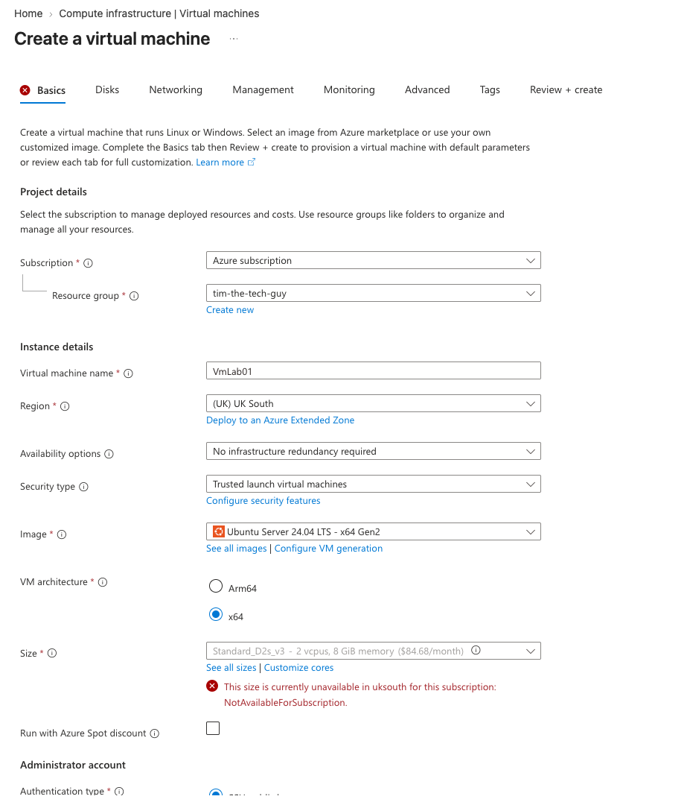
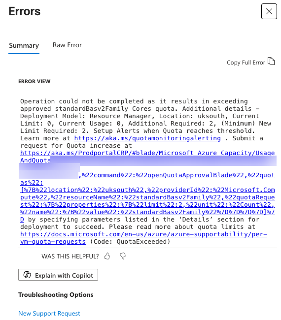

# 08 — Troubleshooting (aka the graveyard)

The actual tunnel came up first time. Getting to that point is where things broke. Here's everything that went wrong, in the order it happened.

---

## 1. North Europe: "VPN Gateway deployments may not succeed in the region"

My first VNet was in North Europe (Dublin). When I opened the gateway wizard, the portal showed a warning that VPN gateways might not deploy there. It's only a warning, so I could have tried anyway, but a failed gateway means waiting 30–45 minutes for nothing.

**What I did:** switched the region dropdown in the wizard to check other regions *before* creating anything. West Europe came up clean, so I deleted the North Europe VNet and rebuilt it there. A VNet can't be moved between regions, and the gateway has to be in the same region as its VNet.

---

## 2. West Europe: "failed because of policy violation"

The VNet in West Europe failed to deploy. Twice.

The first time, the Errors pane said "No errors to view", which wasn't very helpful. The real error was in the 🔔 notification:

So I went to **Policy → Assignments**, expecting to find an "Allowed locations" policy… and there were **zero** assignments.

**Root cause:** new subscriptions come with a hidden, Azure-managed region restriction (`RequestDisallowedByAzure`) that limits you to a set of "best available regions". It doesn't show up under Policy and you can't change it yourself. Only a support request can unlock other regions.

**What I did:** tried **UK South**. The VNet deployed fine and the gateway wizard showed no capacity warning, so everything went there.

**Lesson:** if the portal Errors pane is empty, check the notification bell and the **Activity log** JSON (`code` and `message`). That's where the real reason is.

---

## 3. "Why does my home IP say Google LLC?"

When I checked my public IP in the browser, it said **Google LLC, Data Center, London**. That's not what you expect from a Sky broadband line, so I spent a while checking for VPNs and proxies:
- `route get default` showed `en0`, so no VPN tunnel
- `env | grep -i proxy` showed nothing, and `curl --noproxy` gave the same IP

**Root cause:** there was nothing wrong. The IP `curl -4 ifconfig.me` returned is registered to **Sky**. The website mislabelled it because my browser's **IPv6** traffic was going through a privacy relay, and the page reported that instead. `curl -4` forces IPv4, which goes straight out through the Sky Hub, so it was right all along.

**Lesson:** use the IPv4 address from `curl -4` (or the router's own WAN status page) for the local network gateway, not a "what's my IP" website.

---

## 4. VM size: NotAvailableForSubscription, then QuotaExceeded

- The default size (**D2s_v3**) wasn't available in UK South for my subscription

- My next choice, **B2ats_v2**, failed at validation with **QuotaExceeded**: the Basv2 family had a quota of **0 vCPUs** on my subscription

**What I did:** in the size picker, the B-series were all grouped under "Insufficient quota – family limit". The families at the **top** of the list are the ones you do have quota for, so I picked the cheapest 2-vCPU size in D-series v6 (**D2als_v6**). The wizard kept all my other settings, so I only had to change the size.

**For production:** I'd go to **Quotas → Compute** and request quota for the B-series. Small requests are often approved automatically within minutes.

---

## 5. Double NAT behind the Sky Hub

Not an error exactly, but it needed handling before the tunnel could come up:
- Port-forwarded **UDP 500** and **UDP 4500** on the Sky Hub to the MikroTik, from the Azure gateway's IP only
- UDP 4500 wasn't in the Sky Hub's service list, so I had to create a **custom service** first
- Set **`my-id=address:<public IP>`** on the MikroTik's IPsec identity, so it identifies itself with the public IP Azure expects and not its private 192.168.0.212

Details in [section 6](../06-Home-Network-Sky-Hub-and-MikroTik/README.md).

---

## 6. Smaller things

- **GatewaySubnet naming:** it has to be exactly `GatewaySubnet`. Picking "Virtual Network Gateway" as the subnet purpose names it for you
- **"Deployment failed" after "Download a template for automation":** the first time I downloaded the template from the review page, the wizard seemed to get confused. The second failure was the region policy anyway, but after that I just exported templates from the finished resource instead
- **NIC NSG showing "None" on the VM review page** even though I'd chosen Basic. It was a display glitch, because the NSG was created anyway
- **Chrome offering to save the pre-shared key as a password,** because it thought the Shared Key box was a login field. I clicked No thanks and kept it in my password manager instead
- **Tags not sticking on the VNet:** they were missing on the review page, so I added them afterwards on the resource. Lots of Azure settings can be fixed after creation

---

## Common S2S problems I prepared for (but didn't hit)

| Symptom | Likely cause | Fix |
| --- | --- | --- |
| `NO_PROPOSAL_CHOSEN` | Crypto mismatch | Make both ends match exactly (DH14 = modp2048) |
| `AUTHENTICATION_FAILED` | Pre-shared key mismatch or the wrong identity behind NAT | Re-copy the key, and check `my-id` |
| Phases 1 and 2 up but no ping | Traffic NATed before the IPsec policy is matched | `srcnat accept` above masquerade |
| Ping works but SSH/HTTPS hangs | MTU / fragmentation | Clamp TCP MSS to 1350 |
| Tunnel drops after a while | Home IP changed or lifetimes don't match | Update the local network gateway, or use matching lifetimes |

Useful Azure tools for this: **Network Watcher → VPN troubleshoot**, packet capture on the connection, and the gateway metrics.
