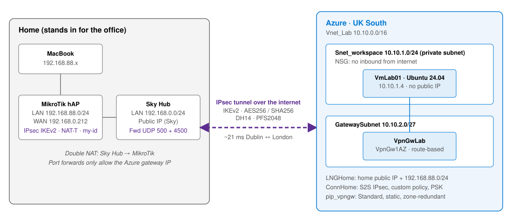

# Azure Site-to-Site VPN Lab (Home Network to Azure)

In this lab I connected my home network to Azure with a site-to-site IPsec VPN. It's the same kind of setup a small company would use to reach its cloud servers privately. At home I've got a MikroTik router sitting behind a Sky Hub, so there's double NAT to deal with. In Azure there's a VPN gateway and a small Ubuntu VM that has no public IP at all. The test was simple: if I could SSH into that VM from my Mac, the tunnel was working.

I wrote it up as if it was a proposal for a real customer, then built it through the Azure portal with screenshots along the way. I've kept the problems I ran into as well, because a couple of them took longer than the build itself.

## The scenario

A 20-person accountancy firm in Dublin (made up for the lab) is moving its main app server to Azure. Staff in the office need to reach it like it's on the local network, but it mustn't be exposed to the internet. They want it done quickly, on the broadband and router they already have, for a predictable monthly cost. A site-to-site VPN covers all of that.

## The lab network

My home LAN is `192.168.88.0/24` behind the MikroTik, and the MikroTik's WAN port sits on the Sky Hub's network at `192.168.0.212`. In Azure I used UK South, with a VNet of `10.10.0.0/16` split into a workload subnet (`10.10.1.0/24`) and the `GatewaySubnet` (`10.10.2.0/27`). The gateway is a route-based VpnGw1AZ, the test VM ended up on `10.10.1.4`, and the tunnel runs IKEv2 with AES256, SHA256 and DH group 14.

## Sections

1. [Planning and design](01-Planning-and-Design/README.md): what the customer needs, why a site-to-site VPN, and the main design choices
2. [Building the Azure side](02-Building-the-Azure-Side/README.md): the VNet, VPN gateway, local network gateway, connection and test VM
3. [Home network: Sky Hub and MikroTik](03-Home-Network-Sky-Hub-and-MikroTik/README.md): getting IPsec through double NAT and configuring the router
4. [Testing the tunnel](04-Testing-the-Tunnel/README.md): ping, SSH and checking the traffic in Azure
5. [Troubleshooting and cleanup](05-Troubleshooting-and-Cleanup/README.md): what went wrong, what it cost, and tearing it all down

There's also a Bicep version of the Azure side in [`infra/`](infra/) with deploy and destroy scripts in [`scripts/`](scripts/), and the RouterOS config in [`mikrotik/`](mikrotik/). The router script uses placeholders, so there are no real IPs or keys in it.

## How it went

The tunnel came up first time once the config was in. Ping from my Mac to the VM came back 4 out of 4 at about 21 ms, which is about right for Dublin to London, and I could SSH straight into a VM with no public IP. Azure's graphs showed the traffic going through the tunnel too.

Everything was deleted afterwards so it wouldn't keep billing, and the port forwards on the Sky Hub and the config on the MikroTik were removed as well. Public IPs and subscription IDs are blurred in the screenshots.
